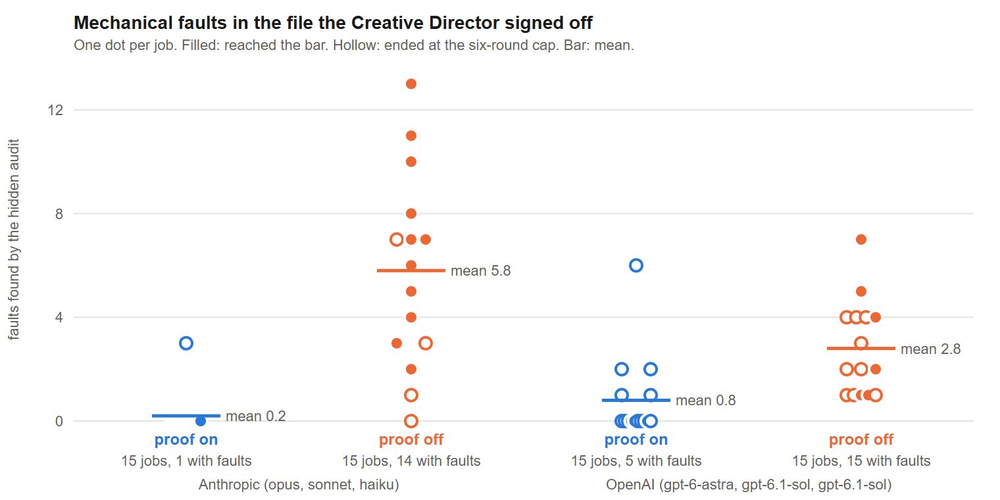
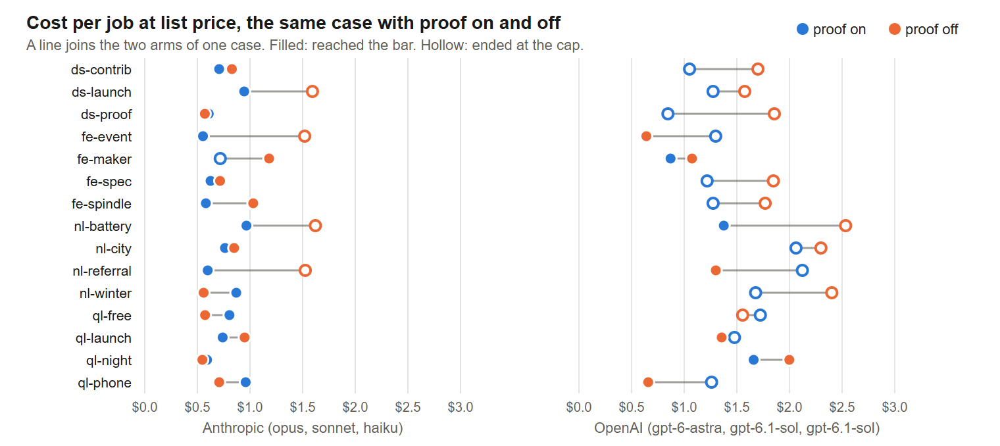
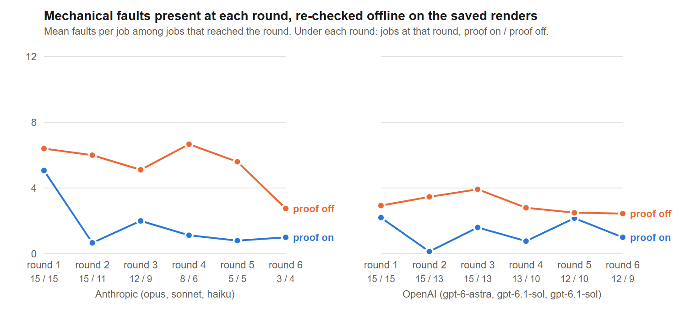

# The judge cannot see the margin: a paired ablation of a mechanical proof step in a model-run design pipeline
Author: Aditya Reddy
Affiliation: Independent researcher
Contact: hello@adityareddy.dev
Date: 20 October 2026

## Abstract

Desk Studio runs a design job as a loop of model calls: a builder polishes a card, a browser renders it, a proof step measures the rendered pixels, and a Creative Director scores the screenshots against a rubric and signs off or sends the round back. Proof is the one step that never calls a model. I asked whether it changes anything when a strong vision model is already looking. I added a flag, `--no-proof`, that skips the checks and leaves everything else in place, and ran 15 cases in both arms and in two model families (claude-opus-5-5 and gpt-6-astra as directors), 60 jobs in 30 pairs, with four hypotheses written down before any job finished. Without proof the director signed off 17 files and all 17 failed a hidden audit. With proof, 0 of 17. Against my prediction, proof cost less, 0.735 against 0.985 USD a job at list price in the Anthropic family (exact p = 0.064) and 1.074 against 1.311 pooled (p = 0.021), because a failed proof round costs a builder call and not a director call. The director's final rubric averages did not differ, 8.49 with proof and 8.43 without (p = 0.307), so its scores carry no trace of the faults. Without proof it named a mechanical fault in 13% of its notes, against 1% with proof, and still signed the faulty files. In 19 of the 30 proof-on jobs a later polish round broke a check an earlier round had passed. The rule I take from this is that anything measurable belongs in a check on the rendered file, run after every round, and the judge keeps what only it can see.

## 1 Introduction

Desk Studio is an open-source design studio for coding agents. Its runner plays a design job as a loop: an intake call writes the brief, three roughs come back, an Art Director picks one, a builder polishes it, a browser renders it, a proof step checks the render, and a Creative Director scores the screenshots against an eight-axis rubric and either signs off or sends notes for another round. Proof is the one checking step in that loop that never calls a model. It opens the rendered file in headless Chrome and measures overflow, the platform's safe zone, contrast on the real pixels behind the text, the type scale, the palette and whether the required copy is present, then hands any failure back to the builder as a note. The director is a strong vision model. The question this paper answers is whether proof changes anything when a director like that is already looking at every round.

There is reason to doubt it does. Feedback loops for generated front-end work are mostly model-judged, with a vision-language critic reading a render [sansford2026vision, lu2025webgenagent], and one poster-generating agent asks such a critic to correct overflow and alignment [pang2025paper2poster]. There is also reason to expect it does. General multimodal models detect overflow and overlap in interfaces poorly [xiang2026uilens] and miss simple visual patterns people take in at once [rahmanzadehgervi2024blind, tong2024eyes], and used as judges they carry known biases [zheng2023judge, chen2024mllmjudge]. A tool's verdict fed back into the loop has helped where unaided revision often has not [gou2024critic, huang2024selfcorrect]. I did not find a study that sets a deterministic pixel check against a vision-model director inside a design loop and reads the result off the files the director signed.

The ablation runs the same loop twice. The on arm is the shipped pipeline. The off arm uses a flag I added to the runner, `--no-proof`, which skips the checks while the round still renders and the director still scores the same screenshots against the same rubric, so one line of the sign-off prompt is the only difference. Fifteen cases, each a LinkedIn card and an Instagram portrait card for one of four made-up brands, run in both arms and in two model families, which gives 60 jobs in 30 pairs. I wrote four hypotheses into the study's README before any job had finished: that signed-off work carries faults the director passed (H1), that proof costs more rounds and more money (H2), that the director's scores do not fall without proof (H3), and that the notes differ in kind (H4).

Three of the four held and one was wrong in direction. All 17 files the off arm signed off failed a hidden audit, and 0 of the 17 signed off with proof did. Proof cost less in both families, cause a round that fails proof costs a builder call at the cheapest tier and no director call at the dearest. The rubric averages were the same in both arms. Without proof the director named a mechanical fault in about one note in eight and still signed the files. The thing I did not predict is that proof has to run every round: in 19 of the 30 proof-on jobs a polish round answering a taste note re-broke a check an earlier round had passed.

The paper contributes the ablation itself, one flag that removes a deterministic step from a model-run pipeline and leaves one prompt line different. It contributes two measures that stand apart from the director, a hidden audit of the signed-off file and an offline recheck of every saved round render, so faults can be followed round by round even where proof never ran. It contributes a coding of all 754 director notes by two independent readers with a third settling disagreements. And it releases every per-job record, so the tables can be rebuilt.

## 2 Method

### 2.1 The pipeline

Desk Studio's runner, `desk-run`, plays a design job as a fixed loop of single-turn model calls, one per desk, each desk working from its own written brief at a director, senior or builder tier. An intake call at the director tier writes a brief with the sizes and the copy that must appear word for word. Three roughs follow in parallel at the senior tier, one for each of the first three composition patterns in the social card standard. The Art Director picks one from the screenshots and writes at most five notes. Rounds then begin. A round is one polish call by the builder, a render, the proof step, and, if proof passes, a sign-off by the Creative Director. A failed proof sends its failures to the builder as the next round's notes and the Creative Director never sees that round, so it costs a round and a builder call but no director call.

The loop counts consecutive misses per failing key, a proof check or a rubric axis under 8. The third consecutive miss of one key sends the next polish round to the senior model, and three more send it to the Art Director, who rewrites the file for one round. A cap on rounds across polish, proof and sign-off ends the job under the bar if reached. I set the cap to 6 for every job, though the runner's default is 8. That lets a job reach the senior model at round 4 at the earliest and never the Art Director, whose first possible round is 7, which matches the runner's own escalation test.

### 2.2 The proof step

Proof runs after every polish round and never calls a model. It opens the file in headless Chrome at each named size at device scale 1, takes a screenshot and a second one with all text made transparent, so the pixels behind the text can be measured, and records every text run. Runs that are hidden, below 0.9 effective opacity or inside a container clipped to one pixel are left out of the text the checks examine. A round passes only if no size has a failure.

| Check | Fails when |
| --- | --- |
| font | the brand's first family is not loaded in the file |
| overflow | the document is over 1 px wider or taller than the canvas, or a text box sits off the canvas or outside a clipping ancestor by over 0.5 px |
| safe zone | a text box crosses 6% of the canvas on any side, or 10% at the bottom of ig-post (135 px) |
| contrast | the worst contrast against the text-hidden render, sampled every 2 px under the box, falls under 4.5:1, or under 3:1 for text at 24 px and up or at 18.67 px and up with weight 700 or more |
| type scale | a size is under 20 px here, or ln(size/base)/ln(ratio) is over 0.12 from a whole number |
| palette | more than 5% of pixels, sampled every 4th both ways, are over 45 RGB units from every brand colour |
| copy | a required string is absent from the rendered text, compared lowercase without whitespace or quote marks, or the page has no readable text |
| size | an email file is over 102 KB, which never applies to these cases |

The sizes are linkedin at 1200x627 and ig-post at 1080x1350. The documentation and the builder prompt call the type scale tolerance 12 percent, though the code measures 0.12 of a scale step, a size error of about 2.7 percent at ratio 1.25.

### 2.3 The sign-off rubric

The Creative Director scores eight axes from 0 to 10 on the screenshots and never on code: hierarchy, typography, spacing and rhythm, colour, composition, originality, brand fit and copy. A job reaches the bar when every axis is 8 or above and the average is 8.5 or above. The runner recomputes the average and the verdict from the eight scores, so the director's own pass line does not decide. The brief says "Be hard on originality and composition" and asks for an instruction with numbers in it on every axis under 9. The sign-off prompt carries the brief, brand, standard, house style, rubric, taste file, the Art Director's pick reason and notes, and one proof line. It carries no earlier scores, so each sign-off judges the current screenshots fresh.

### 2.4 The ablation

`--no-proof` is a flag I added to the runner on a branch of the public repository. With it the proof step still renders the file at the same sizes in the same browser, records a skipped entry and goes straight to sign-off, so no check runs and no failure becomes a note. The one prompt change is a line in the sign-off call. With proof on it reads "Proof passed this round (overflow, safe zone, contrast on real pixels, type scale, palette, copy present)." With proof off it reads "No mechanical proof ran this round."

Everything else is shared, including the models, briefs, rubric, standard, brand file, ladder and cap. That includes two texts that still mention proof. Every prompt carrying the brand file, the directors' included, lists the brand scale as "the only sizes proof accepts", and the runner note tells each desk to skip any proof its brief mentions because the runner runs it after the desk returns. I left both so the arms differ in the check alone, which means an off-arm builder is told the rules and never told whether it broke them. In the off arm every round reaches a sign-off.

### 2.5 Cases and brands

There are 15 cases, each asking for a LinkedIn card and an Instagram portrait card with three required copy lines, a headline, a supporting line and a web address. They come from four made-up brands in the public evals, four cases each for Northlight, Quill and Ferro and three for Desk Studio. A brand file, `DESIGN.md`, holds five named colours, a type family with weights, a base size and ratio for the type scale, a spacing unit and logo clear space, then a short description, a voice line and do and don't lists. Proof reads only the colours, family, base and ratio. The builders and directors read the whole file. All four fonts are bundled and the runner inlines them, so the font check passes in both arms by construction.

| Brand | Family | Base / ratio |
| --- | --- | --- |
| Northlight | Inter | 16 / 1.25 |
| Quill | Source Serif 4 | 17 / 1.333 |
| Ferro | Geist | 16 / 1.25 |
| Desk Studio | Geist | 16 / 1.25 |

Each case runs once per arm per family, so 60 jobs, 30 with proof on and 30 off. Both arms of a case ran side by side, three jobs at a time in the Anthropic family and four in the OpenAI family, both families at once. A call times out at 12 minutes in the Anthropic family, where the director reads screenshots and can take minutes, and at 6 in the OpenAI family, where calls answer in seconds and a stalled stream has to fail fast. A job that fails is resumed once from its saved state, never restarted. Three OpenAI jobs needed that resume and finished, and none failed twice.

### 2.6 Model families and prices

Anthropic runs at the studio preset. OpenAI runs the registry's large model as director and its mini model as both senior and builder, the configuration verified in the public repository's provider evals. I first tried the nano model as builder. In the first three jobs it returned no file at the round cap once and spent six rounds unable to act on taste notes, so both arms would have measured the builder rather than the proof step. Those three jobs are kept aside and are not in the analysis, and the change is dated in the study's README before any other OpenAI job finished. Prices are list prices in US dollars per million tokens. The file also holds cache read and write rates, which the runner applies to OpenAI calls.

| Family | Tier | Model id | Input | Output |
| --- | --- | --- | --- | --- |
| Anthropic | director | claude-opus-5-5 | 4 | 20 |
| Anthropic | senior | claude-sonnet-5-5 | 2 | 10 |
| Anthropic | builder | claude-haiku-5-5 | 0.10 | 0.50 |
| OpenAI | director | gpt-6-astra | 10 | 50 |
| OpenAI | senior | gpt-6.1-sol | 2 | 10 |
| OpenAI | builder | gpt-6.1-sol | 2 | 10 |

The director tier makes the intake, the pick, every sign-off and any Art Director rewrite. The senior tier makes the roughs and escalated polish rounds, and the builder tier the ordinary polish rounds. Proof costs no tokens. Anthropic calls go through the `claude` command line, which reports a cost per call. OpenAI calls go through `codex`, which reports tokens only, so the runner prices them from the table. Director prices differ by a factor of 2.5 across the families, so I compare cost within a family. Because the OpenAI senior and builder are one model, the senior escalation at round 4 changes nothing in that family, and in the Anthropic family it moves the pen from haiku to sonnet.

### 2.7 Measures and the hidden audit

Each job's `state.json` gives reached the bar (the last sign-off passed and the job was not handed back under the bar), rounds (which counts proof-failed rounds), cost by tier, every sign-off's axis scores and notes, and the escalations in its desk list. Three jobs, the resumed ones, have a cost total with some token counts unknown and are flagged, and no job failed after its resume. The state file keeps the number of proof failures per round, and the run log names the failing checks without counting them.

The hidden audit runs once per finished job. The proof command checks the signed-off `final.html` at the job's sizes against the brand file with the case's own three copy lines, taken from the case file and not from the intake's reading of the ask, and writes `audit.json`. No desk sees it. With proof on it repeats a check the last round passed, so it passes by construction unless the job ended at the cap or the intake altered a copy line. With proof off its failures by check count the mechanical faults that reached sign-off.

Every Creative Director note was coded by what it asks the builder to change, into six mechanical categories that mirror the proof checks (safe zone, overflow, contrast, copy, type scale, palette), eight taste categories (hierarchy, composition, spacing, typography, colour, originality, brand, copy) and other. Two readers coded every note independently, each a single call to claude-sonnet-5-5 with a different brief, one as a design director and one as a QA engineer who writes rendering checks, in batches of 25 notes with the category definitions and the rule that a note naming a canvas edge, margin or safe zone is mechanical even when it also talks about balance, and that a size asked for so the text reads at the platform size is mechanical while a size asked for emphasis is taste. A third reader with the same definitions settled every disagreement, seeing both codes and reasons. I report agreement between the two readers at the category level and at the mechanical-or-taste level, and the earlier regular-expression coding stays in the analysis output beside it so the two can be compared.

I also re-ran the checks offline on every saved round render of every job, on arm and off, from the DOM and pixel captures the runner keeps, which gives the mechanical fault count at each round whether or not proof ran. On the on arm this reproduces the proof results exactly.

### 2.8 Analysis

I wrote four hypotheses down before any job finished. With proof off, signed-off work carries mechanical faults the director passed (H1). With proof on, jobs use more rounds and cost more (H2). The director's scores do not fall when proof is off (H3). The notes differ in kind between arms (H4). Within each family I pair jobs by case, test rounds, cost and the final rubric average with an exact two-sided Wilcoxon signed-rank test, and test reaching the bar with an exact McNemar test. Each paired mean difference carries a seeded percentile bootstrap 95% interval, dz and the matched-pairs rank-biserial correlation. Audit failures are counted by check, size and brand. H1 is read on the signed-off files, the jobs that reached the bar, since a job that ends at the cap hands back its last attempt under the bar with the proof report attached rather than a sign-off. The all-jobs figures are reported beside them. Each family gets a table and a pooled table follows, with 15 pairs per family and 30 pooled. The pooled tests are secondary, since the two families differ in model and price. The per-axis comparisons and the first sign-off average are exploratory and unadjusted. I make no claim beyond what 15 pairs carry.

## 3 Related work

Zheng et al. [zheng2023judge] made the case for a strong model as a scorer and named its biases, which is why I never take the Creative Director's marks as ground truth. Chen et al. [chen2024mllmjudge] found that vision-language judges agree closely with people in pairwise comparison but diverge on scores, and still show bias and inconsistency. My director scores screenshots against a rubric, the weaker of those two settings. In both arms it is the same model, and only one line of its sign-off call differs.

Whether a model can correct itself is contested. Huang et al. [huang2024selfcorrect] showed, on reasoning tasks, that models revising their own answers without outside feedback often fail to improve and sometimes get worse. Self-Refine [madaan2023selfrefine] has one model critique and revise its own draft, and Reflexion [shinn2023reflexion] turns feedback into text that the next attempt reads. CRITIC [gou2024critic] lets a tool check the output and has the model revise against the result, which is closest in spirit to the proof step, though the tools there check facts or code. My proof-off arm is only loosely the self-correction case Huang et al. test, since its critic is a separate model at the director tier.

Work on what vision models fail to see gives a reason to expect a screenshot-reading director to miss some mechanical faults. Tong et al. [tong2024eyes] found multimodal models failing at simple visual patterns that people take in at once, and traced the failures to the vision encoder. Rahmanzadehgervi et al. [rahmanzadehgervi2024blind] set simple geometry tasks, such as overlaps and counts, and report that vision-language models fail them. UI-Lens [xiang2026uilens] tests general multimodal models on display defects in interfaces, and its authors describe performance on text overflow and container overlap as near chance. None of these puts the model inside a loop.

Work on model-generated interfaces covers benchmarks and feedback loops. Design2Code [si2025design2code] scores screenshot-to-HTML generation by similarity to a reference page, which my free-form briefs lack. UICrit [duan2024uicrit] grounds model critique of interfaces in human designers' critiques and is the nearest work to my director. Sansford et al. [sansford2026vision] report gains from repeated refinement with a vision-language critic on rendered pages, with no deterministic check in the loop. WebGen-Agent [lu2025webgenagent] pairs screenshot feedback from a vision-language model with an agent that tests function. Pang et al. [pang2025paper2poster] use a vision-language commenter meant to correct overflow and alignment in posters, and their ablation notes it can miss large unused white space without guidance. Calò et al. [calo2026semantic] report semantic accessibility violations in model-generated pages that syntax-level tools miss, a limit on my checker too, which has no view of meaning.

Mechanical checks of rendered pages have a long history in software testing. Walsh et al. [walsh2017layout] detect layout failures in responsive pages without an explicit oracle, by checking that layout stays consistent across viewport widths, and found failures in production pages. My checks have an oracle, written from the brand file and the platform's safe zone. Alshayban et al. [alshayban2020accessibility] found accessibility issues in almost every Android app they analysed. Prevalence like that makes a cheap check easy to justify and says nothing about whether a model-run loop needs one, which is the question here.

The pipeline is also a role-split design. MetaGPT [hong2024metagpt] assigns roles to agents and has them check one another's intermediate outputs. My runner follows the same idea with the checking role made deterministic. I do not evaluate the role split.

## 4 Results

Differences are proof on minus proof off, paired by case within a model family, with the tests and intervals described in section 2.8. Costs are list prices in US dollars as the runner computes them. Both families ran on subscriptions, so none of the figures is a billed amount.

### 4.1 The jobs

All 60 jobs finished: 15 cases in each of two arms in each of two families, 30 complete pairs, 15 per family. Three OpenAI jobs stopped once and resumed from their saved state (the proof-on job for ds-contrib and the proof-off jobs for nl-city and fe-spindle), and the runner flags their cost totals as incomplete because some token counts are unknown. I kept all three in every analysis. Three further OpenAI jobs, run with gpt-6-luna as builder, were set aside at 01:38 CDT on 2026-10-20, before any other OpenAI job had finished, and appear in no table. Seventeen of 30 jobs reached the bar in each arm.

### 4.2 H1: signed-off work carries faults the director passed

Among jobs that reached the bar, every proof-off file failed the hidden audit: 17 of 17 pooled, 11 of 11 in the Anthropic family and 6 of 6 in the OpenAI family. With proof on, none of the 17 files that reached the bar failed, 0 of 14 for Anthropic and 0 of 3 for OpenAI. The OpenAI proof-on figure rests on three files, which is why its interval stretches to 0.56. Counting every job, including those that ended at the cap, the audit failed in 29 of 30 proof-off jobs and 6 of 30 proof-on jobs (Table 1). Each of the six on-arm failures is a job that finished its sixth round on a failing proof, so it was handed back under the bar with the proof report attached and never signed off.

Table 1: Hidden audit of the final file, by arm and family.

| Scope | Arm | Reached the bar, audit failing | 95% CI | All jobs, audit failing | 95% CI | Failure items |
|---|---|---|---|---|---|---|
| Anthropic | on | 0/14 (0%) | [0.00, 0.22] | 1/15 (7%) | [0.01, 0.30] | 3 |
| Anthropic | off | 11/11 (100%) | [0.74, 1.00] | 14/15 (93%) | [0.70, 0.99] | 87 |
| OpenAI | on | 0/3 (0%) | [0.00, 0.56] | 5/15 (33%) | [0.15, 0.58] | 12 |
| OpenAI | off | 6/6 (100%) | [0.61, 1.00] | 15/15 (100%) | [0.80, 1.00] | 42 |
| Pooled | on | 0/17 (0%) | [0.00, 0.18] | 6/30 (20%) | [0.10, 0.37] | 15 |
| Pooled | off | 17/17 (100%) | [0.82, 1.00] | 29/30 (97%) | [0.83, 0.99] | 129 |

Across the final files of all 30 jobs in each arm, the audit counted 129 failure items with proof off and 15 with proof on (Table 2). The safe zone supplied 116 of the 129 off-arm items, spread over 29 of 30 jobs, with type scale adding 7 items in 4 jobs, contrast 4 in one OpenAI job and palette 2 in one Anthropic job. On the on arm the items were 9 in the safe zone across 5 jobs and 6 in contrast in 1 job. Figure 1 plots the per-job counts. The mean number of faults in the final file was 5.8 for Anthropic with proof off and 0.2 with it on, and 2.8 for OpenAI with proof off and 0.8 with it on.

Table 2: Audit failures by check, as items (jobs with at least one, of jobs audited), all jobs.

| Check | Anthropic off | OpenAI off | Pooled off | Pooled on |
|---|---|---|---|---|
| contrast | 0 (0/15) | 4 (1/15) | 4 (1/30) | 6 (1/30) |
| palette | 2 (1/15) | 0 (0/15) | 2 (1/30) | 0 (0/30) |
| safe zone | 82 (14/15) | 34 (15/15) | 116 (29/30) | 9 (5/30) |
| type scale | 3 (2/15) | 4 (2/15) | 7 (4/30) | 0 (0/30) |

*Figure 1: Faults found by the hidden audit in the final file of each job, one dot per job, for each family and arm. Filled dots reached the bar, hollow dots ended at the six-round cap, and the horizontal line marks the mean.*

### 4.3 H2: rounds, cost and where the rounds go

H2 predicted more rounds and a higher cost with proof on, and cost ran the other way (Table 3). Per job it was 0.735 dollars with proof on against 0.985 off for Anthropic, a difference of -0.250 (95% CI [-0.462, -0.053], exact Wilcoxon p = 0.064, dz -0.60). For OpenAI it was 1.413 against 1.638, a difference of -0.225 ([-0.513, 0.072], p = 0.169), and pooled it was -0.237 ([-0.410, -0.058], p = 0.021). Neither family test reaches 0.05 on its own, so the pooled result carries the claim and I treat it as secondary. Rounds rose by 0.53 for Anthropic (3.87 against 3.33, p = 0.265), by 0.80 for OpenAI (5.47 against 4.67, p = 0.250) and by 0.67 pooled ([-0.07, 1.43], p = 0.101), none of them significant. Figure 2 shows the pairs.

Table 3: Paired differences (proof on minus proof off), per job.

| Scope | Measure | Mean on | Mean off | Mean diff | 95% CI | Exact p |
|---|---|---|---|---|---|---|
| Anthropic | Rounds | 3.87 | 3.33 | +0.53 | [-0.53, 1.53] | 0.265 |
| Anthropic | Cost (USD list) | 0.735 | 0.985 | -0.250 | [-0.462, -0.053] | 0.064 |
| Anthropic | Cost, director | 0.548 | 0.740 | -0.191 | [-0.350, -0.042] | 0.064 |
| Anthropic | Cost, senior | 0.167 | 0.227 | -0.060 | [-0.113, -0.011] | 0.169 |
| Anthropic | Cost, builder | 0.020 | 0.018 | +0.002 | [-0.006, 0.008] | 0.303 |
| Anthropic | Sign-off calls | 1.73 | 3.33 | -1.60 | [-2.60, -0.67] | 0.011 |
| Anthropic | Escalations | 0.07 | 0.87 | -0.80 | [-1.53, -0.13] | 0.094 |
| Anthropic | Wall seconds | 282 | 380 | -98 | [-196, -5] | 0.107 |
| OpenAI | Rounds | 5.47 | 4.67 | +0.80 | [-0.20, 1.93] | 0.250 |
| OpenAI | Cost (USD list) | 1.413 | 1.638 | -0.225 | [-0.513, 0.072] | 0.169 |
| OpenAI | Cost, director | 0.992 | 1.271 | -0.279 | [-0.534, -0.022] | 0.083 |
| OpenAI | Cost, senior | 0.168 | 0.231 | -0.063 | [-0.117, -0.008] | 0.055 |
| OpenAI | Cost, builder | 0.252 | 0.136 | +0.116 | [0.057, 0.170] | 0.003 |
| OpenAI | Sign-off calls | 2.93 | 4.67 | -1.73 | [-2.87, -0.47] | 0.013 |
| OpenAI | Escalations | 0.33 | 1.93 | -1.60 | [-2.33, -0.80] | 0.005 |
| OpenAI | Wall seconds | 347 | 392 | -46 | [-115, 30] | 0.277 |
| Pooled | Rounds | 4.67 | 4.00 | +0.67 | [-0.07, 1.43] | 0.101 |
| Pooled | Cost (USD list) | 1.074 | 1.311 | -0.237 | [-0.410, -0.058] | 0.021 |
| Pooled | Cost, director | 0.770 | 1.005 | -0.235 | [-0.383, -0.084] | 0.008 |
| Pooled | Cost, senior | 0.168 | 0.229 | -0.061 | [-0.100, -0.024] | 0.014 |
| Pooled | Cost, builder | 0.136 | 0.077 | +0.059 | [0.025, 0.095] | 0.003 |
| Pooled | Sign-off calls | 2.33 | 4.00 | -1.67 | [-2.40, -0.90] | <0.001 |
| Pooled | Escalations | 0.20 | 1.40 | -1.20 | [-1.73, -0.63] | <0.001 |
| Pooled | Wall seconds | 314 | 386 | -72 | [-134, -10] | 0.044 |

Pooled, director cost fell by 0.235 dollars per job (p = 0.008) and senior cost by 0.061 (p = 0.014), while builder cost rose by 0.059 (p = 0.003). The builder rise belongs to the OpenAI family at +0.116 (p = 0.003), against +0.002 for Anthropic (p = 0.303). A proof-failed round has no sign-off, and sign-off calls per job fell from 4.00 to 2.33 pooled (p < 0.001, r = -0.76). Escalations to the senior pen fell from 1.40 to 0.20 (p < 0.001, r = -0.91). Wall time fell by 72 seconds, from 386 to 314 (p = 0.044).

In the proof-on arm the first round failed proof in 29 of 30 jobs, 14 of 15 for Anthropic and 15 of 15 for OpenAI. A job averaged 2.33 proof-failed rounds and 7.77 failure items, and its first passing round came at a mean of 2.23 and a median of 2. Every proof-on job passed proof at least once. Counted as job-rounds in which a check appeared, the safe zone fired in 29 of the 30 first rounds and in 63 job-rounds overall, with type scale in 7, contrast in 5, overflow in 2 and copy in 1.

*Figure 2: Cost per job at list price for the same case with proof on and off, for the 15 cases in each family. A line joins the two arms of one case. Filled dots reached the bar, hollow dots ended at the cap.*

### 4.4 The offline recheck

I re-ran the checks on every saved round render of every job in both arms, which gives a fault count at each round whether or not proof ran (Table 4, Figure 3). On the on arm this reproduces the proof results exactly. The recheck is not among the measures in the README. I added it after the analysis output of 02:30 CDT, and it is the one measure in the paper that was not written down in advance.

Table 4: Mean faults per job at each round, offline recheck, with the number of jobs reaching the round in brackets.

| Round | Anthropic on | Anthropic off | OpenAI on | OpenAI off |
|---|---|---|---|---|
| 1 | 5.07 (15) | 6.40 (15) | 2.20 (15) | 2.93 (15) |
| 2 | 0.67 (15) | 6.00 (11) | 0.13 (15) | 3.46 (13) |
| 3 | 2.00 (12) | 5.11 (9) | 1.60 (15) | 3.92 (13) |
| 4 | 1.13 (8) | 6.67 (6) | 0.77 (13) | 2.80 (10) |
| 5 | 0.80 (5) | 5.60 (5) | 2.17 (12) | 2.50 (10) |
| 6 | 1.00 (3) | 2.75 (4) | 1.00 (12) | 2.44 (9) |

Proof-on jobs start high and drop sharply, from 5.07 faults at round 1 to 0.67 at round 2 for Anthropic and from 2.20 to 0.13 for OpenAI, then climb again at round 3 to 2.00 and 1.60. Proof-off jobs show no such drop. Anthropic stands at 6.40 at round 1 and stays between 5.11 and 6.67 through round 5, while OpenAI moves from 2.93 to 3.46 and 3.92 and ends at 2.44 by round 6. Jobs drop out as they finish, down to 3 and 4 at Anthropic round 6, so the later means rest on fewer jobs. In the on arm, 19 of 30 jobs had a proof failure after an earlier round had passed, 33 such rounds in all, most often on the safe zone. In the off arm, faults rose from one round to the next in 21 of 90 round transitions. No off-arm job was clean at round 1, and one on-arm job was, the Anthropic job for ql-phone.

*Figure 3: Mean mechanical faults per job at each round, re-checked offline on the saved renders, for each family and arm. Each mean covers the jobs that reached that round, and the counts under each round give the jobs with proof on and with proof off.*

### 4.5 H3 and H4: scores and the director's notes

The final rubric average showed no detectable difference between arms (Table 5). It was 8.50 with proof on and 8.49 off for Anthropic (p = 0.595), 8.47 against 8.37 for OpenAI (p = 0.355), and 8.49 against 8.43 pooled, a difference of +0.05 ([-0.08, 0.17], p = 0.307). Reaching the bar did not differ either, with 14 of 15 on against 11 of 15 off for Anthropic (McNemar exact p = 0.375), 3 of 15 against 6 of 15 for OpenAI (p = 0.375) and 17 of 30 in each arm pooled (5 pairs on only, 5 off only, p = 1.000).

Table 5: Rubric scores, proof on minus proof off. Two of the 24 exploratory per-axis comparisons are shown, and the full set is in the analysis output.

| Scope | Measure | Mean on | Mean off | Mean diff | 95% CI | Exact p |
|---|---|---|---|---|---|---|
| Anthropic | Final average | 8.50 | 8.49 | +0.01 | [-0.20, 0.17] | 0.595 |
| OpenAI | Final average | 8.47 | 8.37 | +0.10 | [-0.05, 0.27] | 0.355 |
| Pooled | Final average | 8.49 | 8.43 | +0.05 | [-0.08, 0.17] | 0.307 |
| Anthropic | First sign-off average (exploratory) | 8.42 | 8.27 | +0.15 | [-0.04, 0.41] | 0.357 |
| OpenAI | First sign-off average (exploratory) | 8.44 | 8.28 | +0.17 | [0.00, 0.33] | 0.075 |
| Pooled | First sign-off average (exploratory) | 8.43 | 8.27 | +0.16 | [0.03, 0.31] | 0.024 |
| OpenAI | Final originality (exploratory) | 6.53 | 6.87 | -0.33 | [-0.80, 0.13] | 0.313 |
| OpenAI | Final typography (exploratory) | 8.73 | 8.27 | +0.47 | [0.13, 0.80] | 0.063 |

The OpenAI originality axis finished at 6.53 on and 6.87 off, while every other OpenAI axis averaged above 7.8 in both arms. The final originality score was 6 in 10 of the 15 proof-on OpenAI jobs and 8 of the 15 proof-off ones. All 21 OpenAI jobs under the bar scored below 8 on originality, and in 16 of them it was the only axis below 8. The exploratory first sign-off average was higher with proof on by 0.16 pooled (p = 0.024, unadjusted), which runs against the direction H3 predicted. The only per-axis final with an interval clear of zero was OpenAI typography at +0.47 (p = 0.063, unadjusted), and the next smallest p is 0.229.

For H4, two readers coded all 754 Creative Director notes independently and a third settled the 73 category disagreements. They agreed on 681 notes across fifteen categories, 90% with Cohen's kappa 0.88, and on 740 at the level of mechanical, taste or other, 98% with kappa 0.90. Under the final codes, 68 of 522 proof-off notes (13%) named a mechanical fault, against 3 of 232 proof-on notes (1%). The off-arm notes named the safe zone 28 times, type scale 20, palette 11, overflow 5, copy 3 and contrast once, while the on-arm notes named the safe zone twice and copy once. All 11 palette notes came from the OpenAI off arm (Table 6).

Table 6: Final codes of the Creative Director notes, by family and arm.

| Code | Anthropic on | Anthropic off | OpenAI on | OpenAI off |
|---|---|---|---|---|
| mechanical: contrast | 0 | 0 | 0 | 1 |
| mechanical: copy | 1 | 2 | 0 | 1 |
| mechanical: overflow | 0 | 4 | 0 | 1 |
| mechanical: palette | 0 | 0 | 0 | 11 |
| mechanical: safe zone | 1 | 16 | 1 | 12 |
| mechanical: type scale | 0 | 14 | 0 | 6 |
| Mechanical, all | 2 | 36 | 1 | 32 |
| Taste, all | 100 | 196 | 129 | 252 |
| Other | 0 | 2 | 0 | 4 |
| Notes | 102 | 234 | 130 | 288 |
| Mechanical share | 2% | 15% | 1% | 11% |

Per job, a proof-on job drew 0.10 mechanical director notes against 2.27 for a proof-off job, lower in 19 of 30 pairs and higher in 1. Taste notes ran 7.63 against 14.93, lower in 21 pairs and higher in 8. The on arm produced 70 sign-offs and the off arm 120, since a proof-failed round has no sign-off.

In round 1 of the on arm, 109 proof failure items went to the builder across the 30 jobs, against 4 director notes, because only one job passed proof that round, so almost everything the builder heard in round 1 was mechanical. From round 2 the proof-on notes were at most 3% mechanical, at 0 of 73, 1 of 45, 1 of 48, 1 of 35 and 0 of 27 in rounds 2 to 6. Proof-off notes stayed between 7% and 15% in every round, from 16 of 124 in round 1 to 4 of 58 in round 6.

Six notes were coded other, two from Anthropic off and four from OpenAI off. The two Anthropic notes say that the copy lines are locked and nothing changes. Among the OpenAI notes, one asks for "the required overflow, contrast and safe-zone checks" to be run before sign-off and says "this round has no mechanical proof" (openai/off/ds-proof, round 1). The other three ask for the embedded font weights to be verified, because "screenshots alone cannot confirm" them.

The regular-expression coding in the analysis output overcounted mechanical notes, at 44 of 232 on-arm notes (19%) and 96 of 522 off-arm notes (18%). It matched the term "edge", which also appears in layout wording such as "right edge", and 116 of its 140 mechanical notes matched on that term alone. With the term removed the share was 3% in each arm. Under that coding the two arms did not differ, whereas the two readers found 1% against 13%, so the contrast between arms rests on the readers' codes and I treat those as the primary result.

## 5 Discussion

Every one of the 17 files the director signed off without proof failed the audit, and the fault it passed most was the safe zone, 116 items in 29 of the 30 off-arm files. My reading is that the director passed them because it sees the card only as a screenshot, at a scale where a 6% margin and a 2.7% size error do not show. Vision-language models are reported to fail on simple geometry such as line intersections and overlapping shapes [rahmanzadehgervi2024blind], and to score close to chance on text overflow and container overlap in interface pages [xiang2026uilens]. I did not test what the director resolves, so this stays a reading of its notes, though the notes fit it. Without proof the director named a mechanical fault in 68 of its 522 notes. The faults it named were mostly the ones that show at screenshot scale, 20 notes on type size and 11 on palette, and those two checks reached the audit in only 4 and 1 of the 30 files. The safe zone was different: 28 notes against faults in 29 of the 30 files. The director also said as much itself. In one OpenAI job without proof it asked for "the required overflow, contrast and safe-zone checks" before sign-off, and that job ran to the cap with a safe-zone fault still in the file. Three other notes asked for the embedded fonts to be verified because "screenshots alone cannot confirm" them. A judge that knows what it cannot see is still a judge that signs.

Proof is not a tax. I had written down that it would cost more and use more rounds, and the money went the other way in both families, 0.735 against 0.985 USD for Anthropic and 1.413 against 1.638 for OpenAI, with the pooled difference of 0.237 at p = 0.021 and neither family test under 0.05 on its own. The mechanism is in Table 3. A round that fails proof costs a builder call at the cheapest tier and no director call at the dearest, so the off arm made 4.00 sign-off calls a job against 2.33, director spend fell by 0.235 USD a job, and builder spend rose by 0.059. Escalations to the senior pen fell from 1.40 a job to 0.20, cause the ladder counts a rubric axis under 8 as a miss and a director that keeps sending a margin fault back as a composition note trips it. Rounds rose by 0.67 (p = 0.101), which at this sample size I do not read as an effect. Wall time fell by 72 seconds.

The scores did not move. The final rubric average was 8.49 with proof and 8.43 without, and 17 of 30 jobs reached the bar in each arm, with the families going opposite ways. The exploratory first sign-off average was 0.16 higher with proof, which if anything is the wrong direction for H3 and which I do not lean on. This is what the judge-as-metric literature predicts, a judge that scores what it can see and diverges from human raters when it gives scores rather than comparisons [chen2024mllmjudge]. It also means the rubric average, which is the number the pipeline reports and the number anyone running such a loop would watch, would have hidden the whole effect. A pooled average of 8.43 sat on 30 files of which 29 failed the audit.

Proof has to run in every round. In 19 of the 30 on-arm jobs a round failed proof after an earlier round had passed, 33 such rounds in all, most often on the safe zone, and in the off arm faults rose from one round to the next in 21 of 90 transitions. The picture in Figure 3 is of a builder that clears the margin when told to and then, asked to fill an empty band or let the headline carry the canvas, moves the type back into it. A one-time check at the end would catch the last state, but by then the director has spent rounds scoring files that were going to be sent back anyway. The check belongs between every polish and every sign-off, which is where the shipped pipeline has it.

What proof does not do is also clear. The OpenAI family reached the bar in 3 of 15 jobs with proof and 6 of 15 without, and that is about originality, not margins. All 21 OpenAI jobs under the bar scored below 8 on originality, in 16 of them as the only failing axis, and the builder did not move it in either arm. Proof removes one class of fault and leaves taste alone, which is the division of labour the loop was built on.

For anyone building a model-run loop that produces an artefact, the practical reading is narrow and I think it holds beyond design. Turn every requirement that can be measured into a check on the rendered artefact, run it after every round, and make it a gate the judge never overrides, as here, where a round that fails proof never reaches the Creative Director. That is tool-interactive critiquing [gou2024critic] aimed at pixels, and automated layout-failure detection on rendered pages has a precedent in software testing [walsh2017layout]. Keep the judge model for the axes no check covers, originality above all, and stop asking it to certify margins. And audit the signed-off file with the check, not with the judge's score.

## 6 Limitations

Each family has 15 pairs and every case ran once per arm, so one run stands for each case. The pooled difference of +0.67 rounds and the per-axis figures are not established, and the family-level cost differences are suggestive rather than settled. The setting is narrow too, one pipeline making social cards for four made-up brands at two sizes.

The audit applies the same checks as the proof step, so a fault here is whatever proof defines as one. The safe zone accounts for 116 of the 129 off-arm audit failures, so the audit result is mostly a statement about a 6% margin, 10% at the bottom of the portrait card. Platforms do crop and overlay those regions, which is why the rule exists, though I have no designer's judgement on whether each breach would have been noticed.

Costs are list prices computed by the runner, not what was billed, and three OpenAI totals are incomplete because some token counts were unknown. The families differ in price, so I compare cost within a family and treat the pooled cost test as secondary.

Both arms' prompts still mention proof in two places, so an off-arm builder is told the rules and no check tells it whether it broke them. The sign-off line, the one intended difference, was read as an instruction once, when an OpenAI off-arm director asked for the checks to be run, noting that "this round has no mechanical proof". The six-round cap means the Art Director's pen never occurs, and OpenAI jobs mostly end at the cap.

Two model readers with different briefs coded the 754 notes and a third settled 73 disagreements, with no human designer involved. The kappa of 0.88 measures agreement between those readers, both running on claude-sonnet-5-5, so their mistakes may be shared, and model judges have known biases [zheng2023judge]. The off-arm mechanical share is 13% by their coding and 18% by the earlier regular expression, which overcounted for a reason I can name.

I built the pipeline being measured and ran the study. I wrote the four hypotheses into the README at 01:25 CDT, after the jobs started and before any finished, which limits that only so far, since it is a dated file and not an outside registration. The OpenAI builder changed from gpt-6-luna to gpt-6.1-sol at 01:38 CDT, after three jobs, so that family's configuration was chosen with early outcomes in view, and the README dates the change. The offline recheck was added after the analysis.

More cases with several runs each would settle the rounds and per-axis differences, and a second person running the arms would take my hand out of the measured system. Designers marking the same files would say whether the margin breaches matter, and a sample of the notes coded by people would show whether the readers' codes match a human reading. Stripping both mentions of proof from the off-arm prompts would show what the leftover wording does, and a higher cap would show where the capped OpenAI jobs end. Whether the result leaves social cards needs other standards and real brands.

## 7 Conclusion

I asked whether a mechanical proof step changes what a model-run design pipeline hands back, or whether a screenshot-reading director already catches those faults. On 15 cases in two model families, the files that reached sign-off carried mechanical faults in 17 of 17 jobs without the step and in 0 of 17 with it. The step cost less, not more, cause a failed proof round costs a builder call and not a director call, and the director's rubric average was the same in both arms, so its scores carry no trace of the faults. The director passes the margin above all, and a pass at one round does not hold: in 19 of 30 proof-on jobs a later polish round broke a check an earlier round had passed. The rule I take from this is to turn every requirement that can be measured into a check on the rendered artefact, run it after every round, and leave the judge the things only it can see. The per-job records, the scripts and the `--no-proof` flag are released with this paper.

## 8 Data and code

The pipeline is Desk Studio, at https://github.com/adityareddy-dev/deskstudio under the MIT licence. The `--no-proof` flag is a small change to `runner/run.mjs` on the branch `study/no-proof` of that repository. The study record is at https://github.com/adityareddy-dev/deskstudio-proof-ablation and archived at Zenodo, https://doi.org/10.5281/zenodo.23493779 (version 1.0.0). It holds, for each of the 60 jobs, the manifest, the run log, the hidden audit, the offline recheck of every round, the brief, the full state file with every sign-off's scores and notes, the signed-off `final.html`, the handback and the 2,000 round renders, together with the case file, the batch runner, the recheck and analysis scripts, the two readers' codes for all 754 notes with the adjudicated final code, the figures, and the preregistered design note with its dated change. The three nano-builder jobs set aside before analysis are in the record under their own folder.
